<div align="center">

# 小元工作手机 · 企业工作手机 / 销售管控 / 微信管控解决方案

**小元工作手机** 是一套面向销售团队的 **企业工作手机** 系统：管理后台 + 工作手机 APP + 定制 ROM 级管控，
覆盖 **通话录音、微信管控、客户管理、防飞单、防删除、手机管控、SCRM 私域运营** 全链路。

[功能总览](#-核心功能) · [管理后台](#-管理后台截图) · [工作手机-app](#-工作手机-app截图) · [行业对比](#-与同类工作手机产品) · [商务合作](#-商务合作--联系我们) · [English](#english)

</div>

---

## 📌 什么是工作手机？

**工作手机**（又称企业工作手机、销售工作手机、管控手机）是企业统一配发给销售/客服人员的业务手机。
通过系统级能力，把员工手机里的 **电话、短信、微信、企业微信、客户资料** 沉淀为企业资产：
员工离职客户不流失、聊天记录不丢失、违规行为可预警、销售过程可量化。

小元工作手机适用于：教育培训、房产中介、汽车销售、金融保险、医美、招商加盟、电销团队等需要 **销售管控** 与 **客户资产保护** 的行业。

## ✨ 核心功能

| 模块 | 能力 |
|---|---|
| 📞 通话管理 | 系统级 **通话录音** 自动上传、通话记录、外呼任务 / 群呼任务、有效通话时长、接通率统计、来电/挂机弹屏 |
| 💬 微信管控 | 员工 **微信聊天记录存档**、好友/群统计、语音通话记录、敏感词与敏感操作预警（删好友、转账、红包等）、**防删除**、重复好友检测、群发助手、登录日志 |
| 👥 客户管理（CRM / SCRM） | 客户列表、企业公海、客户分组/标签/自定义字段、自动分配、查重与报备、跟进提醒、客户删除规则、离职员工客户一键交接 |
| 🛡️ 防飞单 | AI 飞单预警、敏感词质检、私加好友/私发号码识别、通讯录管控、客户号码隐藏 |
| 📱 手机管控 | 应用管控（黑白名单、禁止双开/卸载）、相机/截屏/文件分享管控、WiFi 与域名/IP 黑白名单、机卡绑定、插拔卡记录、定位与电子围栏、手机截屏与相册审计、远程策略推送 |
| 🤖 AI 质检 | 客户意向/情绪/异议/痛点分析、竞品提及、流失原因、员工情绪、会话质检规则 |
| 📊 数据中心 | 工作概览、通话分析、微信统计、短信统计、手机使用统计、打卡统计、自定义报表、数据大屏、工作量统计 |
| 🌐 私域运营 | 微信/企微助手：朋友圈、群发、自动加好友、客户唤醒、活码、营销素材中心、话术库 |
| 🏢 多组织 | 总部 / 分公司（校区）多级架构、角色权限、产品授权、操作日志、开放平台 / OpenAPI |

## 🖥️ 管理后台截图

> 截图来自本地测试环境，数据为测试数据，手机号已脱敏、姓名已模糊处理。

**首页 · 经营总览**

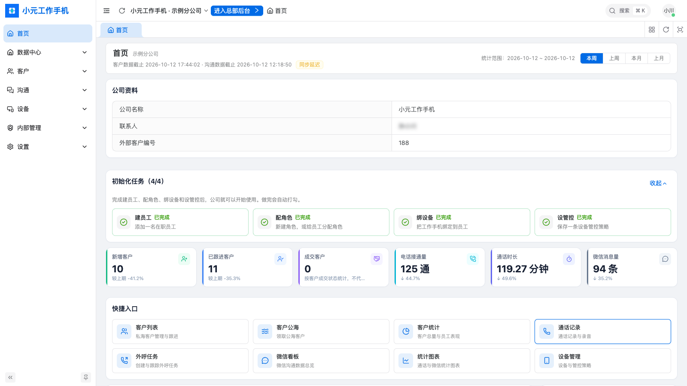

**数据中心 · 工作概览 / 通话分析 / 微信统计**

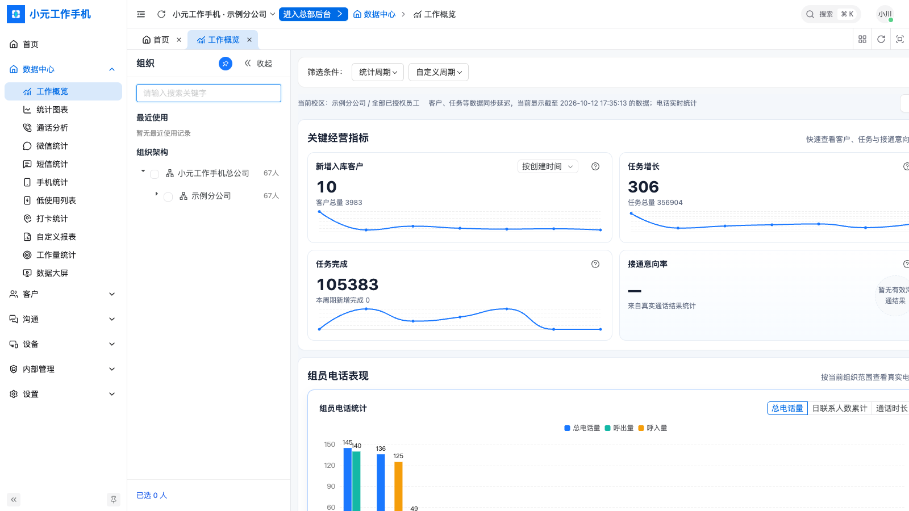
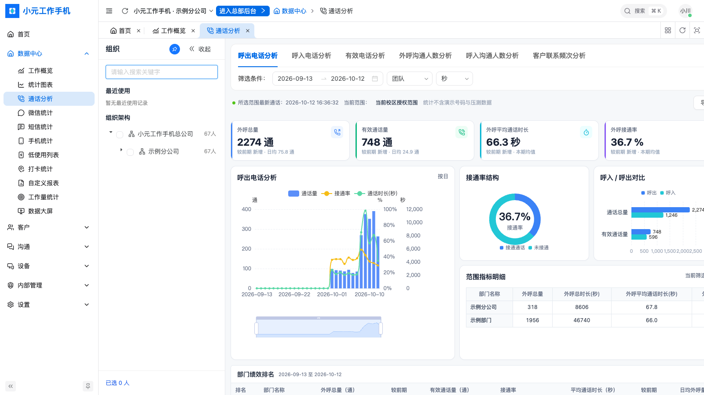
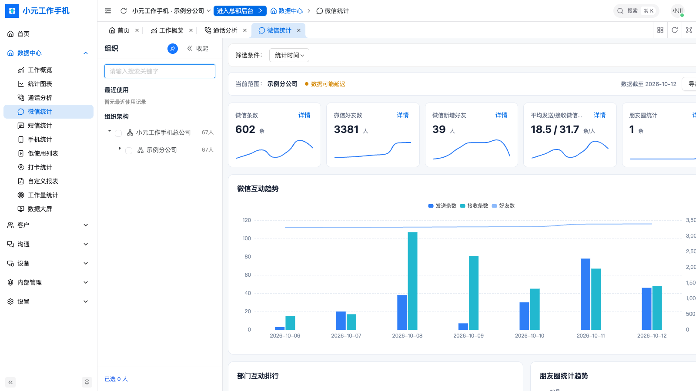

**客户管理 · 客户列表 / 通话录音记录**

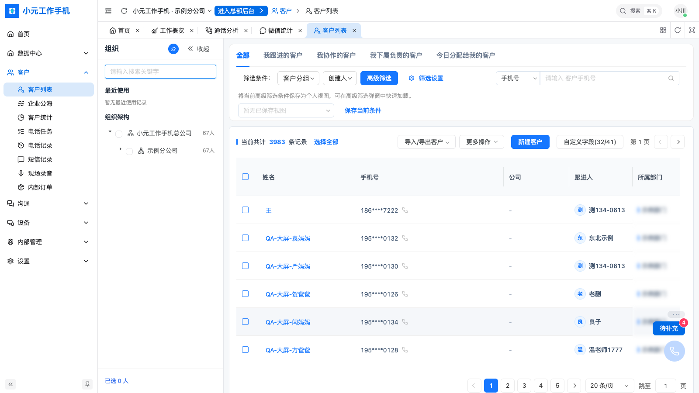
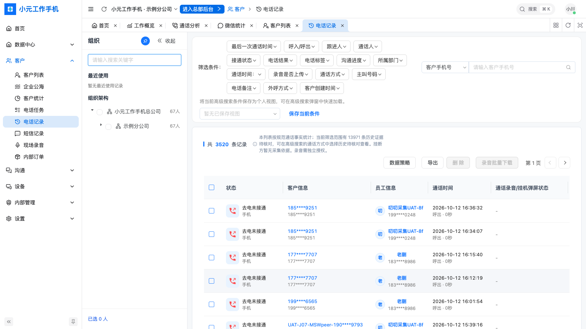

**手机管控 · 设备统计 / 设备管控策略 / 应用监控**

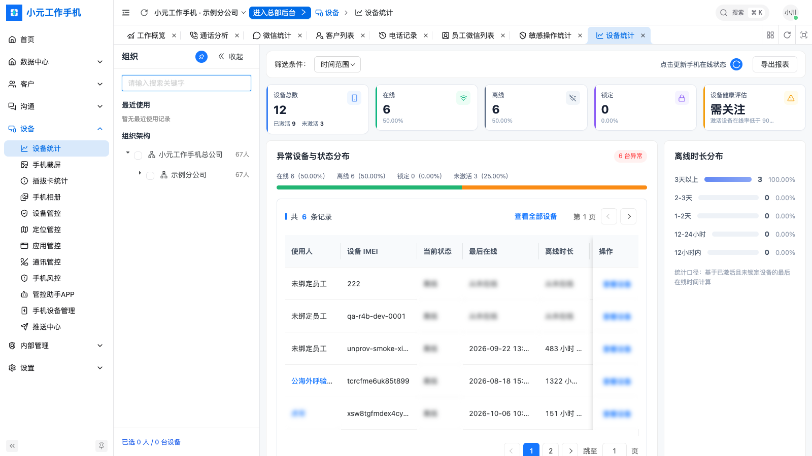
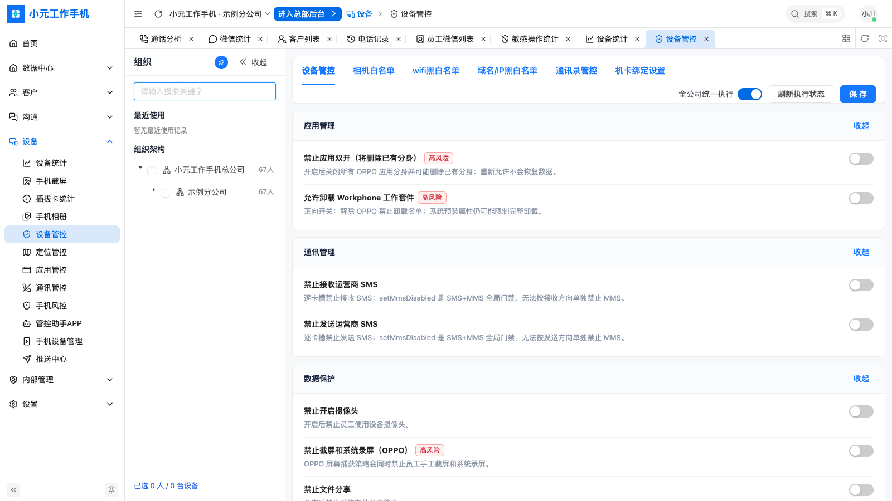
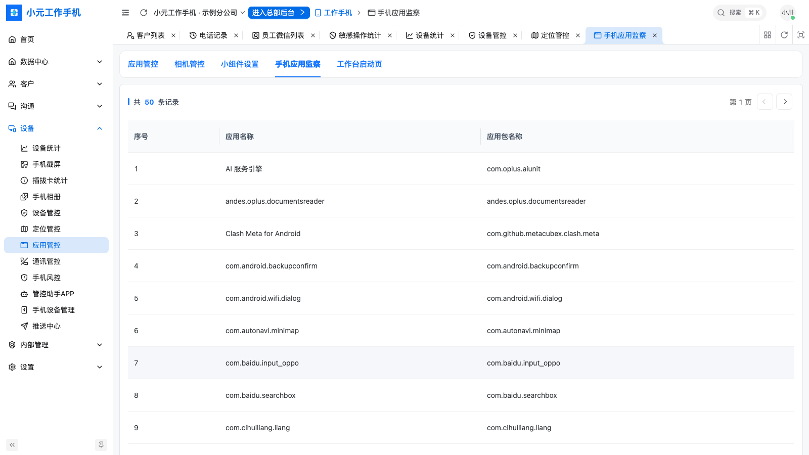

## 📱 工作手机 APP截图

工作手机端由「工作中心」APP + 系统级组件（拨号/录音、管控、连接服务、OTA 升级）组成，员工开箱即用。
当前底部导航：**消息 · 团队 · 管理 · 客户 · 应用 · 我的**（截图来自 OPPO 测试机最新安装包）。

| 消息 / 今日概况 | 客户列表 | 客户详情 / 跟进 |
|---|---|---|
| 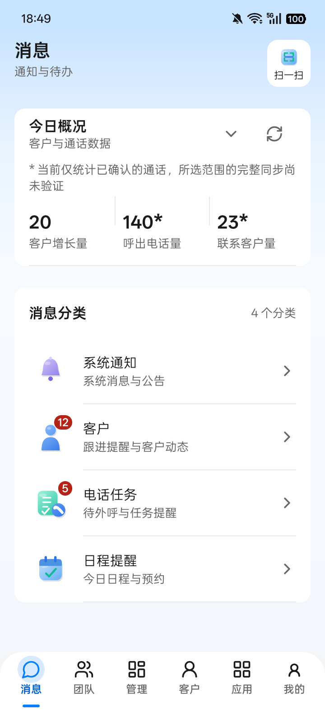 | 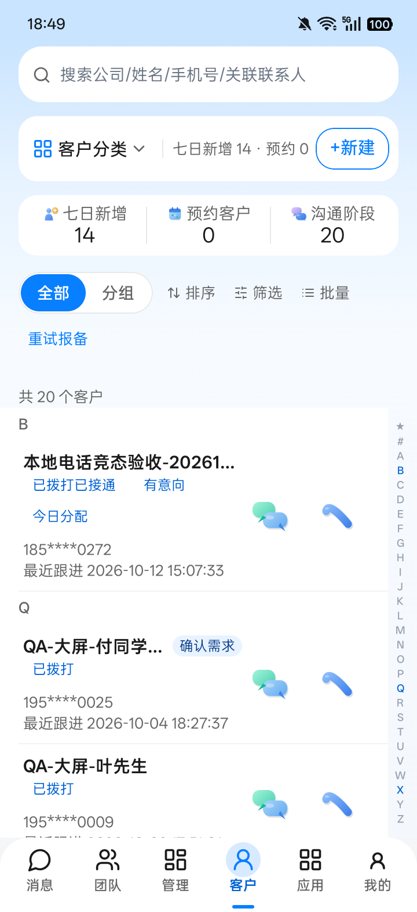 | 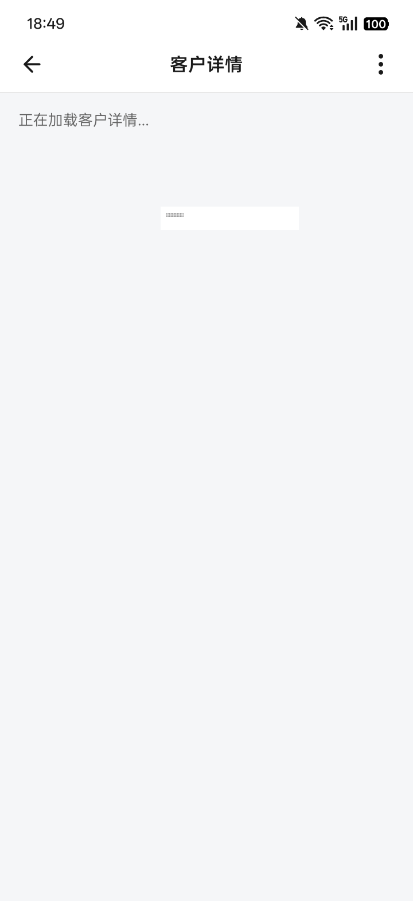 |

| 应用中心 | 个人统计 | 我的 |
|---|---|---|
| 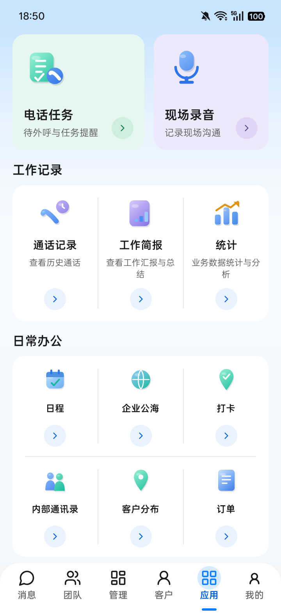 | 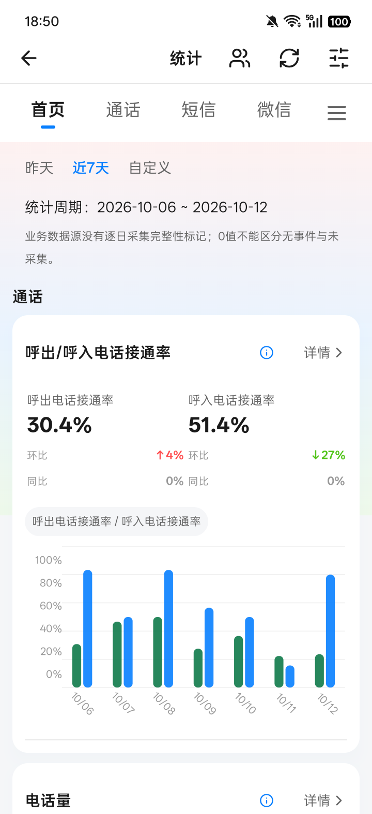 | 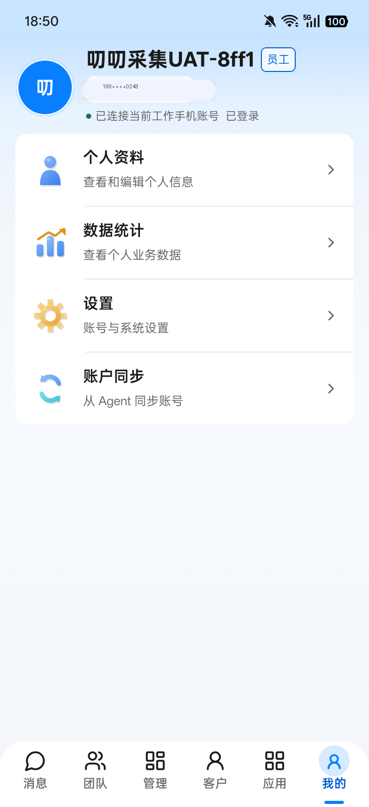 |

| 团队看板（新） | 管理经营数据（新） |
|---|---|
| 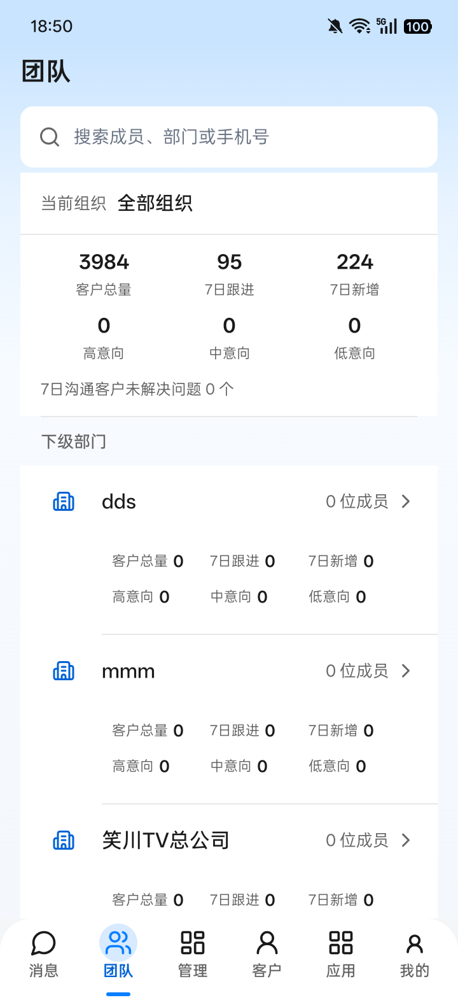 | 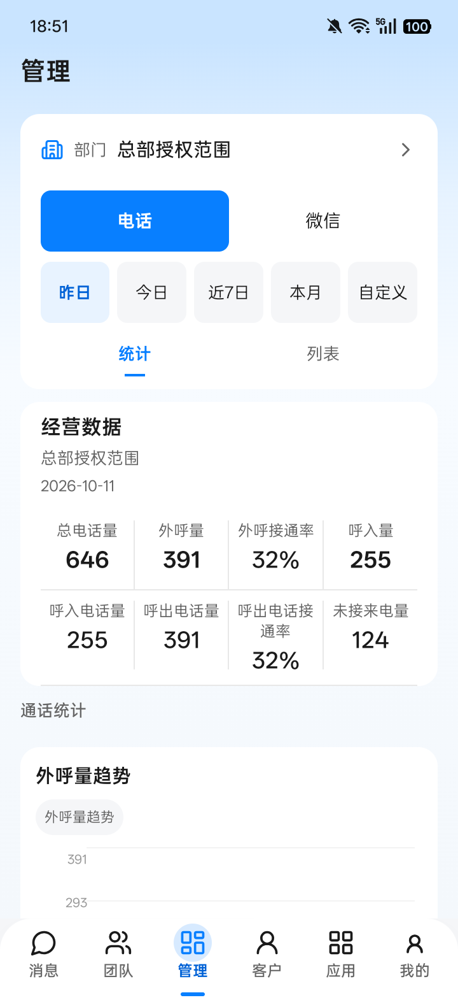 |

APP 主要能力：一键拨号与自动 **通话录音**、客户跟进时间轴、写跟进/附件、电话任务、现场录音、工作简报、企业公海、日程与打卡、团队/管理看板、个人数据统计（通话/短信/微信）、微信/企微快捷联系。

## 🏗️ 系统架构

```
┌──────────────┐   HTTPS / WebSocket   ┌──────────────────┐
│ 工作手机 APP  │ ───────────────────▶ │  服务端 (Java)    │ ◀── 管理后台 (Vue3 + Ant Design Vue)
│ 工作中心/拨号 │                       │  客户·通话·微信·设备 │
│ 管控/OTA/系统 │ ◀─── 策略下发 ──────── │  AI 质检 · OpenAPI │ ──▶ 第三方 CRM / 业务系统
└──────────────┘                       └──────────────────┘
```

- 管理后台：Vue 3 + Vite + Ant Design Vue
- 服务端：Spring Boot + MySQL + Redis
- 终端：Android 原生（Kotlin），支持 OPPO / vivo 等机型系统级管控

## 🔍 与同类工作手机产品

如果你正在调研 **云客工作手机**、**先发工作手机**、**无极工作手机** 等企业工作手机方案，小元工作手机提供同类的通话录音、微信管控、客户管理、手机管控能力，可作为 **替代方案 / 备选方案** 一并评估。
欢迎联系我们获取演示环境，按你的业务场景实际对比。

> 以上产品名称仅用于说明产品类别，商标归各自权利人所有，本项目与其无关联。

## 🤝 商务合作 / 联系我们

- 电话：`19012779793`
- QQ：`416450997`
- 邮箱：`416450997@qq.com`
- 微信：扫下方二维码添加（微信号与昵称以微信为准）


## 🏷️ 关键词

工作手机 · 小元工作手机 · 企业工作手机 · 销售工作手机 · 销售管控 · 微信管控 · 微信聊天记录存档 · 通话录音 · 客户管理 · CRM · SCRM · 私域 · 防飞单 · 防删除 · 手机管控 · 企业手机管理 · 云客工作手机替代 · 先发工作手机替代 · 无极工作手机替代

---

## 📂 开源代码结构（精简版）

本仓库公开的是**可运行的精简骨架**，用于展示产品信息架构与技术分层，**不包含**完整业务实现、签名证书、内部域名或客户数据。

```
xiaoyuan-work-phone/
├── admin-lite/          # 管理后台精简版（Vue3 + Ant Design Vue，Mock 数据）
│   ├── src/layouts/     # 侧栏布局
│   ├── src/router/      # 路由：工作概览 / 客户 / 通话录音 / 微信管控 / 手机管控
│   ├── src/views/       # 展示页
│   └── src/mock/        # 本地假数据，无真实 API
├── app-lite/            # 工作手机 APP 精简架构（Android 多模块）
│   ├── common/          # BaseActivity、HttpClient、ApiPaths
│   └── workbench/       # 「工作中心」演示：客户列表、通话录音（Mock）
├── docs/images/         # 管理后台与 APP 截图、微信联系二维码
├── README.md
└── LICENSE
```

### 本地运行

```bash
# 管理后台精简版
cd admin-lite && npm install && npm run dev   # http://localhost:5777

# APP 精简版（需 Android SDK / JDK 17）
cd app-lite && ./gradlew :workbench:assembleDebug
```

`app-lite` 中 `API_BASE_URL` 默认为 `https://api.example.com`，仅占位。

## English

**Xiaoyuan Work Phone (小元工作手机)** is an enterprise *work phone* solution for sales teams in China: an admin console, an Android work-phone app and system-level device management. Features include automatic **call recording**, **WeChat monitoring & archiving**, **customer management (CRM/SCRM)**, anti-deal-diversion (防飞单) alerts, anti-deletion, app/camera/WiFi/SIM **device control**, AI conversation QA and data dashboards. It is an alternative to products in the same category such as Yunke / Xianfa / Wuji work phones.

Contact: see the *商务合作* section above.

## License

[MIT](LICENSE)
